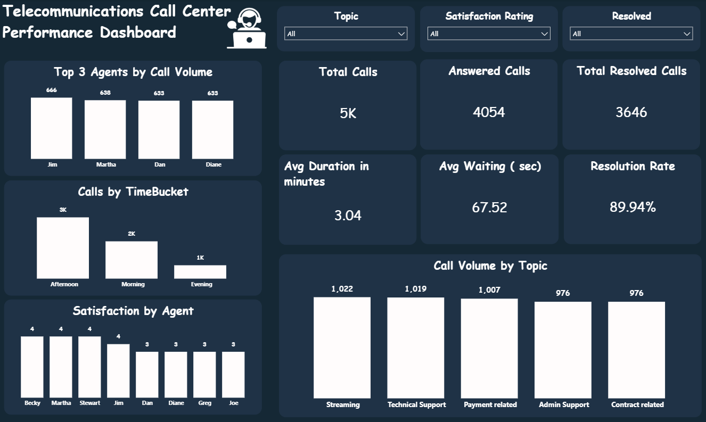

# 📞 Telecom Call Center Performance Dashboard

### How well is the call center performing, and where can it improve?

---

## 🎯 The Problem

A call center lives and dies by how fast it answers and how many problems it solves. This project analyzes **5,000 customer calls** to measure performance, spot busy periods, and compare agents, so managers can plan staffing and improve service.

---

## 📸 Dashboard Preview

---

## 🔍 What I Analyzed

- 📞 **Call volume**: total, answered, and resolved calls
- ✅ **Resolution rate** and how many calls get solved
- ⏱️ **Average call duration** and **waiting time**
- 🕒 **Busy periods**: calls by morning, afternoon, and evening
- 🧑‍💼 **Agent performance**: call volume and satisfaction ratings
- 📂 **Call topics**: what customers call about the most

---

## 📊 Headline Numbers

| Metric | Value |
|:---|:---:|
| Total calls | **5,000** |
| Answered calls | **4,054** |
| Resolved calls | **3,646** |
| Resolution rate | **89.94%** |
| Avg call duration | **3.04 min** |
| Avg waiting time | **67.52 sec** |

---

## 💡 Key Insights

- **Afternoons are the busiest:** about 3K calls come in during the afternoon, versus 2K in the morning and 1K in the evening, so staffing should follow that peak.
- **Around 1 in 5 calls goes unanswered:** only 4,054 of 5,000 calls were answered (about 81%), which is the biggest gap to close.
- **Strong resolution:** 89.94% of answered calls get resolved.
- **Calls are spread evenly across topics:** Streaming (1,022), Technical Support (1,019), and Payment (1,007) lead, with Admin Support and Contract (976 each) close behind. No single topic dominates.
- **Workload is balanced between top agents:** Jim leads with 666 calls, with Martha, Dan, and Diane between 633 and 638.
- **Customers wait over a minute on average**, which is worth reducing.

### ✅ Recommendations
- Add more agents during afternoon hours to cut waiting time and unanswered calls
- Investigate why about 19% of calls go unanswered
- Share best practices from the agents with the highest satisfaction ratings

---

## 🛠️ Tools & Workflow

| Step | Tool | What I did |
|:---|:---|:---|
| 1️⃣ Clean | Excel | Checked data quality and prepared the dataset |
| 2️⃣ Model | Power BI | Built the data model and DAX measures |
| 3️⃣ Visualize | Power BI | Designed an interactive dashboard with KPI cards and filters |

---

## 🚀 How to Explore It

1. Download `Telecom_Call_Center.pbix` from this repo
2. Open it in **Power BI Desktop**
3. Use the slicers to filter by topic, satisfaction rating, and resolved status

The raw data is in `Telecom_Call_Center.xlsx`.

---

## 📬 Let's Connect

⭐ *If you liked this project, drop a star!*

